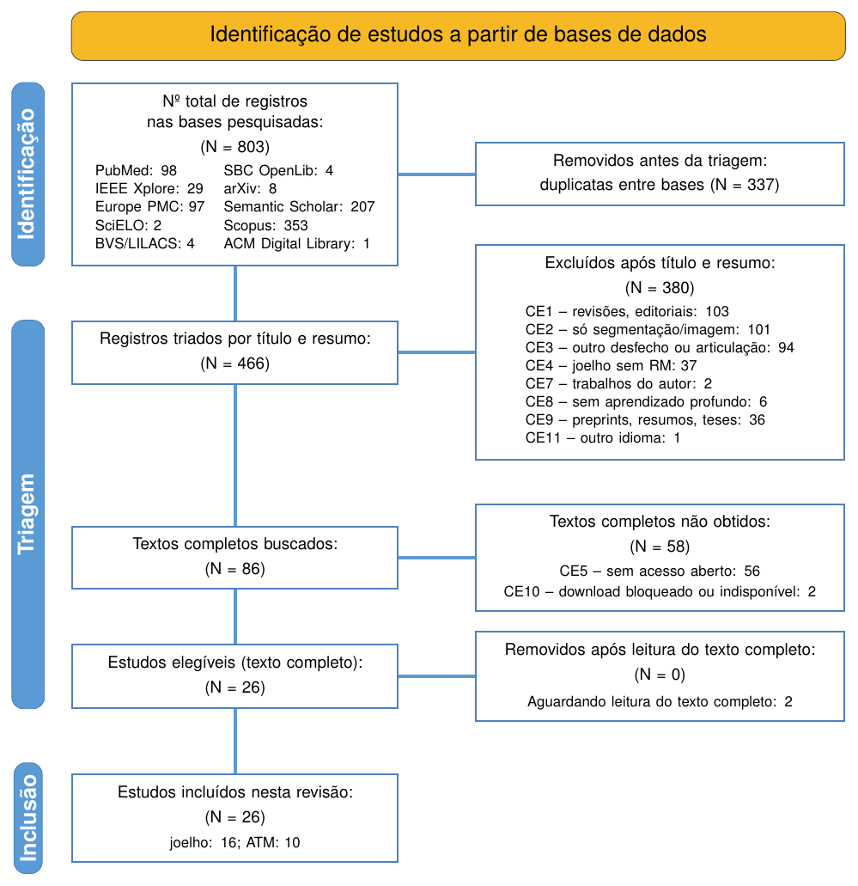

<p align="center">
  
  &nbsp;&nbsp;&nbsp;&nbsp;
  
</p>

<h1 align="center">prisma-oa-knee-tmj-dl</h1>

<p align="center">
  <b>Structured literature review (PRISMA 2020) on deep learning for osteoarthritis of the knee (MRI) and the temporomandibular joint</b><br>
  Revisão estruturada da literatura (PRISMA 2020) sobre aprendizado profundo para osteoartrite do joelho (RM) e da articulação temporomandibular
</p>

<p align="center">
  Thalles Cotta Fontainha · Orientador: Prof. Felipe da Rocha Henriques<br>
  Programa de Pós-Graduação em Instrumentação e Óptica Aplicada (PPGIO) · UFCI/RJ (antigo CEFET/RJ) e UFF<br>
  <i>Versão 2.2.0 · buscas de 21 e 22/11/2026 · ver <a href="CHANGELOG.md">CHANGELOG</a></i>
</p>

---

## Sobre

Este repositório guarda a busca, a triagem e a lista de estudos da revisão do Capítulo 3 do projeto de tese apresentado no exame de qualificação do doutorado no PPGIO. A mesma base vai servir para a tese. Qualquer pessoa pode refazer as buscas, conferir por que cada registro entrou ou saiu e chegar aos mesmos números do fluxograma.

**Pergunta da revisão.** Que estudos usam aprendizado profundo para classificar, graduar ou detectar osteoartrite do joelho em ressonância magnética, ou da ATM em qualquer modalidade de imagem, e o que dizem sobre representação volumétrica e transferência de conhecimento com poucos dados?

> **English summary.** Reproducible search in 10 databases (4 health, 6 computing/multidisciplinary, including Scopus and ACM DL via the CAPES portal), screening decisions with criterion codes for all 803 records, an auto-generated PRISMA 2020 flow diagram, and the list of 26 included studies (with licences) for a PhD project on 3D CNNs for joint MRI with limited labelled data (knee-to-TMJ transfer).

## Resultado

<p align="center"></p>

| Área | Base | Strings | Identificados | Após duplicatas (T1) | Após título/resumo (T2) | Incluídos |
|---|---|---|---|---|---|---|
| Saúde | PubMed/MEDLINE | B1 / B2 | 75 / 23 | 75 / 23 | 16 / 12 | 9 / 5 |
| Computação | IEEE Xplore | B1 / B2 | 26 / 3 | 24 / 3 | 15 / 2 | 1 / 0 |
| Saúde | Europe PMC | B1 / B2 | 72 / 25 | 22 / 5 | 2 / 0 | 1 / 0 |
| Saúde | SciELO | S1 | 2 | 1 | 0 | 0 |
| Saúde | BVS/LILACS | S1 (DeCS) | 4 | 3 | 0 | 0 |
| Computação | SBC OpenLib (SBCAS) | S2 | 4 | 4 | 0 | 0 |
| Computação | arXiv | B1 / B2 | 8 / 0 | 6 / 0 | 0 | 0 |
| Computação | Semantic Scholar | B1 / B2 | 171 / 36 | 73 / 13 | 12 / 5 | 4 / 5 |
| Multidisciplinar | Scopus (Portal CAPES) | B1 | 353 | 214 | 22 | 1 (2 aguardando) |
| Computação | ACM Digital Library (Portal CAPES) | B1 / B2 | 1 / 0 | 0 / 0 | 0 | 0 |
| | **Total** | | **803** | **466** | **86** | **26** |

**Pendentes:** Scopus B2 (zero relatado, implausível) e Web of Science (consulta recusada pela interface) precisam ser executados de novo. **Não executadas:** Embase e dblp. Detalhes e passo a passo em [`docs/bases.md`](docs/bases.md). Dois registros do Scopus em acesso aberto aguardam a leitura do texto completo.

A lista dos 26 estudos, com links e licenças, está em [`docs/lista_pdfs.md`](docs/lista_pdfs.md). O BibTeX está em `references/included_studies.bib`.

**Síntese:** [`docs/sintese.md`](docs/sintese.md) traz o resumo de cada estudo, a relação com a tese e os padrões que aparecem no conjunto. O principal é que nenhum estudo transfere um modelo do joelho para a ATM.

## Strings de busca

As strings completas de cada base, na sintaxe que foi de fato executada, estão em [`src/config.py`](src/config.py). A lógica comum é:

| Código | Lógica booleana |
|---|---|
| **B1 – joelho** | (osteoartrite do joelho) **AND** (RM) **AND** (aprendizado profundo **OR** rede neural convolucional) **AND** (classificação **OR** graduação **OR** diagnóstico **OR** detecção) |
| **B2 – ATM** | (ATM **OR** transtornos da ATM) **AND** (osteoartrite **OR** doença articular degenerativa) **AND** (aprendizado profundo **OR** rede neural convolucional) |
| **S1** | B1 e B2 juntas numa string só, com termos em português e inglês e sem o bloco de RM. Usada no SciELO e na BVS, que são bases pequenas e com interface limitada |
| **S2** | osteoarthritis **OR** osteoartrite **OR** temporomandibular **OR** knee **OR** joelho. Usada na SBC OpenLib, porque a busca do OJS não aceita parênteses aninhados |

Exemplo, B1 na sintaxe do PubMed:

```
("Osteoarthritis, Knee"[MeSH] OR "knee osteoarthritis"[tiab]) AND ("Magnetic Resonance Imaging"[MeSH] OR MRI[tiab]
OR "magnetic resonance"[tiab]) AND ("Deep Learning"[MeSH] OR "Neural Networks, Computer"[MeSH] OR "deep learning"[tiab]
OR "convolutional neural network*"[tiab]) AND (classif*[tiab] OR grading[tiab] OR diagnos*[tiab] OR detection[tiab])
AND 2021:2026[dp]
```

Os descritores vêm do DeCS/MeSH (BVS): Osteoartrite (D010003), Osteoartrite do Joelho (D020370), Articulação Temporomandibular (D013704), Transtornos da ATM (D013705), Imageamento por Ressonância Magnética (D008279), Aprendizagem Profunda (D000077321) e Redes Neurais de Computação (D016571).

## Critérios

| Código | Critério | Etapa |
|---|---|---|
| CI1 | Estudo primário com aprendizado profundo que classifica, gradua ou detecta OA (ou achado degenerativo) do joelho ou da ATM | T2 |
| CI2 | Joelho: o resumo indica entrada de RM. ATM: qualquer modalidade de imagem | T2 |
| CI3 | Publicado entre 2021 e 2026, em inglês ou português | busca |
| CI4 | Texto completo em acesso aberto | T3 |
| CE1 | Revisão, revisão sistemática, meta-análise, bibliometria, editorial, perspectiva ou retratação | T2 |
| CE2 | Apenas segmentação, quantificação, reconstrução ou melhoria de imagem | T2 |
| CE3 | Outro desfecho ou articulação (progressão, prótese, lesão ligamentar ou meniscal, outra doença) | T2 |
| CE4 | Joelho sem RM (radiografia, TC, sensores ou texto clínico) | T2 |
| CE5 | Texto completo sem acesso aberto | T3 |
| CE6 | Duplicata de registro já identificado numa base anterior | T1 |
| CE7 | Trabalho do próprio autor, já apresentado nas Contribuições 1 e 2 | T2 |
| CE8 | Não usa aprendizado profundo (só aprendizado de máquina clássico) | T2 |
| CE9 | Não é artigo completo revisado por pares (preprint, tese, resumo de congresso ou parecer) | T2 |
| CE10 | Texto completo não obtido: acesso aberto, mas o download foi bloqueado ou falhou no site da editora | T3 |

## O que é automático e o que não é

| Etapa | Como é feita | Arquivo |
|---|---|---|
| Busca | Automática nas bases com API; pela interface web no SciELO, na BVS e na SBC | `src/search_*.py`, `docs/bases.md` |
| T1 – duplicatas | Por PMID, DOI e título, na ordem de `DEDUP_ORDER` | `data/screening_decisions.csv` (CE6) |
| T2 – título e resumo | **Decisão do revisor**, registrada com o código do critério | `data/screening_decisions.csv` |
| T3 – acesso ao texto completo | Flag de acesso aberto de cada base, conferida pela licença no Crossref | `data/screening_decisions.csv` (CE5) |
| Números, tabela e fluxograma | Automáticos, a partir do CSV | `src/prisma_counts.py` |

O código não decide se um artigo entra: ele busca e soma. Cada número do fluxograma corresponde a linhas do CSV, com o código do critério aplicado.

## Como reproduzir

```bash
python src/search_pubmed.py           # PubMed (E-utilities); opcional: export NCBI_API_KEY=...
python src/search_europepmc.py        # Europe PMC (REST, sem chave)
python src/search_arxiv.py            # arXiv (API pública)
python src/search_semanticscholar.py  # Semantic Scholar; recomendado: export S2_API_KEY=...
export IEEE_API_KEY=...               # chave gratuita em https://developer.ieee.org
python src/search_ieee.py
python src/prisma_counts.py           # recalcula números, tabela e figures/prisma2020.tex a partir do CSV
cd figures && pdflatex prisma2020.tex # gera o PDF do fluxograma
python src/download_oa_pdfs.py        # baixa os PDFs de acesso aberto que estão no PMC
```

Os scripts usam só a biblioteca padrão do Python 3.9+. Os resultados das bases mudam com o tempo, por inclusão e reindexação de registros, e por isso a data da busca fica registrada em `src/config.py`.

## Estrutura

```
src/          strings (config.py), scripts de busca, contagem e fluxograma
data/         screening_decisions.csv (803 registros), scopus_b1_2026-11-22.csv, prisma_counts.json, selection_table.md
docs/         bases.md (como cada base foi consultada), lista_pdfs.md (26 estudos, links, licenças),
              sintese.md (resumo de cada estudo e relação com a tese)
references/   included_studies.bib e included_studies.csv
figures/      prisma2020.tex / .pdf / .png
pdfs/         PDFs dos incluídos cuja licença permite redistribuição
assets/       logotipos da UFCI/RJ e do PPGIO
```

## Limitações

- Revisão estruturada, não revisão sistemática completa: um único revisor fez a triagem, e não há avaliação de risco de viés.
- Scopus, Web of Science, Embase, ACM DL e dblp ainda não foram executadas.
- O critério de acesso aberto (CI4) excluiu 37 registros potencialmente relevantes (CE5 no CSV). Se o critério passar a aceitar o acesso pelo Portal CAPES, eles voltam para a avaliação de texto completo.
- Dois estudos de acesso aberto foram excluídos por CE10, porque o PDF não pôde ser obtido em 21/11/2026: Manfredonia et al. (2024), cujo download na SciTePress exige CAPTCHA e falhou, e Yan (2021), cujo site (Hindawi/Wiley) bloqueou o acesso. Se forem obtidos depois, voltam para a avaliação de texto completo.
- Alguns incluídos vêm de periódicos de menor impacto. A inclusão segue os critérios, não a qualidade do periódico; a qualidade é discutida na síntese da tese.

## Como citar

Use o botão *Cite this repository* do GitHub (arquivo `CITATION.cff`).

## Referências

- PAGE, M. J. *et al.* The PRISMA 2020 statement: an updated guideline for reporting systematic reviews. *BMJ*, v. 372, n71, 2021. https://doi.org/10.1136/bmj.n71
- RETHLEFSEN, M. L. *et al.* PRISMA-S: an extension to the PRISMA Statement for Reporting Literature Searches in Systematic Reviews. *Systematic Reviews*, v. 10, 39, 2021. https://doi.org/10.1186/s13643-020-01542-z
- BIREME/OPAS/OMS. DeCS – Descritores em Ciências da Saúde. https://decs.bvsalud.org
- NATIONAL LIBRARY OF MEDICINE. Medical Subject Headings (MeSH). https://www.nlm.nih.gov/mesh

## Licenças

- Código (`src/`): MIT (arquivo `LICENSE`).
- Dados de busca e triagem (`data/`, `docs/`, `references/`): CC BY 4.0.
- PDFs (`pdfs/`): cada um mantém a licença original do artigo, indicada em `references/included_studies.csv`.
- Logotipos (`assets/`): marcas da UFCI/RJ e do PPGIO, usadas só para identificar a instituição.
