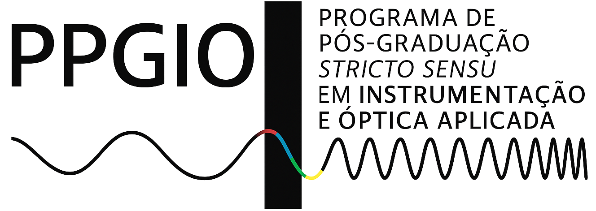
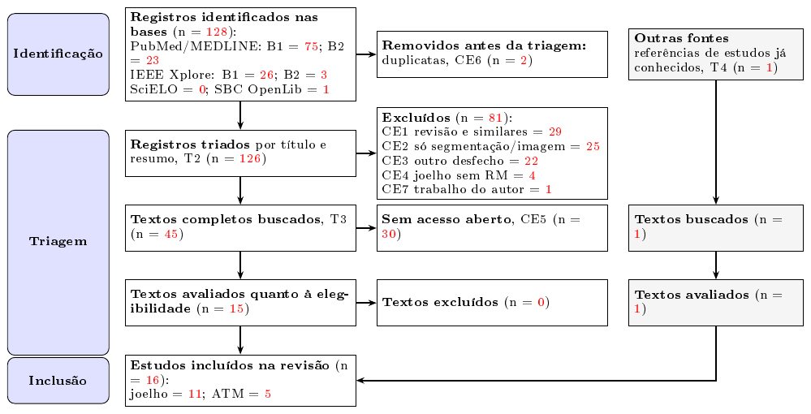

<p align="center">
  
  &nbsp;&nbsp;&nbsp;&nbsp;
  
</p>

<h1 align="center">prisma-oa-knee-tmj-dl</h1>

<p align="center">
  <b>Structured literature review (PRISMA 2020) on deep learning for osteoarthritis of the knee (MRI) and the temporomandibular joint</b><br>
  Revisão estruturada da literatura (PRISMA 2020) sobre aprendizado profundo para osteoartrite do joelho (RM) e da articulação temporomandibular
</p>

<p align="center">
  Thalles Cotta Fontainha · Orientador: Prof. Felipe da Rocha Henriques<br>
  Programa de Pós-Graduação em Instrumentação e Óptica Aplicada (PPGIO) · UFCI/RJ (antigo CEFET/RJ) e UFF
</p>

---

## Sobre

Este repositório guarda a busca, a triagem e os estudos incluídos na revisão do Capítulo 3 do projeto de tese apresentado no exame de qualificação do doutorado no PPGIO. O objetivo é que qualquer pessoa possa refazer a busca, conferir por que cada registro entrou ou saiu e chegar aos mesmos números do fluxograma.

**Pergunta da revisão.** Que estudos usam aprendizado profundo para classificar, graduar ou detectar osteoartrite do joelho em ressonância magnética, ou da ATM em qualquer modalidade de imagem, e o que dizem sobre representação volumétrica e transferência de conhecimento com poucos dados?

> **English summary.** Reproducible search (PubMed and IEEE Xplore), screening decisions with criterion codes, PRISMA 2020 flow diagram and the list of included studies for a PhD project on 3D CNNs for joint MRI with limited labelled data (knee to TMJ transfer).

## O que é automático e o que não é

| Etapa | Como é feita | Arquivo |
|---|---|---|
| Busca (strings booleanas) | Automática, por código | `src/config.py`, `src/search_pubmed.py`, `src/search_ieee.py` |
| T1 – duplicatas | Por DOI e título | `data/screening_decisions.csv` (código CE6) |
| T2 – título e resumo | **Decisão do revisor**, registrada com o código do critério | `data/screening_decisions.csv` |
| T3 – acesso ao texto completo | Flag de texto completo gratuito do PubMed e acesso aberto do IEEE | `data/screening_decisions.csv` (CE5) |
| Contagens do PRISMA | Automática, a partir do CSV | `src/prisma_counts.py` |

A triagem de título e resumo não é feita por código: o script só soma as decisões. Assim, todo número do fluxograma corresponde a linhas do CSV.

## Busca

Data: 21/11/2026 · Período: 2021–2026 · Descritores: DeCS/MeSH (BVS) combinados com termos livres em título e resumo.

| Código | String (sintaxe PubMed) | PubMed | IEEE Xplore |
|---|---|---|---|
| B1 – joelho | `("Osteoarthritis, Knee"[MeSH] OR "knee osteoarthritis"[tiab]) AND ("Magnetic Resonance Imaging"[MeSH] OR MRI[tiab] OR "magnetic resonance"[tiab]) AND ("Deep Learning"[MeSH] OR "Neural Networks, Computer"[MeSH] OR "deep learning"[tiab] OR "convolutional neural network*"[tiab]) AND (classif*[tiab] OR grading[tiab] OR diagnos*[tiab] OR detection[tiab])` | 75 | 26 |
| B2 – ATM | `("Temporomandibular Joint"[MeSH] OR "Temporomandibular Joint Disorders"[MeSH] OR temporomandibular[tiab]) AND ("Osteoarthritis"[MeSH] OR osteoarthritis[tiab] OR "degenerative joint disease"[tiab]) AND ("Deep Learning"[MeSH] OR "Neural Networks, Computer"[MeSH] OR "deep learning"[tiab] OR "convolutional neural network*"[tiab])` | 23 | 3 |

No IEEE Xplore, que não usa MeSH, a mesma lógica é aplicada ao campo *Abstract* (ver `src/config.py`). B1 é estreita porque a literatura do joelho é grande; B2 é ampla porque a da ATM é pequena.

## Critérios

| Código | Critério |
|---|---|
| CI1 | Estudo primário com aprendizado profundo que classifica, gradua ou detecta OA (ou achado degenerativo) do joelho ou da ATM |
| CI2 | Joelho: entrada de RM. ATM: qualquer modalidade de imagem |
| CI3 | Publicado entre 2021 e 2026, em inglês ou português |
| CI4 | Texto completo em acesso aberto |
| CE1 | Revisão, revisão sistemática, meta-análise, bibliometria, perspectiva ou retratação |
| CE2 | Apenas segmentação, quantificação, reconstrução ou melhoria de imagem |
| CE3 | Outro desfecho (progressão, prótese, lesão ligamentar ou meniscal, outra doença) |
| CE4 | Joelho com entrada só de radiografia ou de texto clínico |
| CE5 | Texto completo sem acesso aberto |
| CE6 | Registro duplicado entre bases |
| CE7 | Trabalho do próprio autor, já apresentado nas Contribuições 1 e 2 |

## Resultado

<p align="center"></p>

| Fonte | String | Identificados | T1 | T2 | T3 | Incluídos |
|---|---|---|---|---|---|---|
| PubMed/MEDLINE | B1 | 75 | 75 | 16 | 9 | 9 |
| PubMed/MEDLINE | B2 | 23 | 23 | 12 | 5 | 5 |
| IEEE Xplore | B1 | 26 | 24 | 15 | 1 | 1 |
| IEEE Xplore | B2 | 3 | 3 | 2 | 0 | 0 |
| SciELO | B1/B2 | 0 | 0 | 0 | 0 | 0 |
| SBC OpenLib | B1/B2 | 1 | 1 | 0 | 0 | 0 |
| Outras fontes (T4) | – | 1 | 1 | 1 | 1 | 1 |
| **Total** | | **129** | **127** | **46** | **16** | **16** |

Os 16 estudos incluídos estão em `references/included_studies.bib` e `references/included_studies.csv` (com DOI, PMCID e licença). Os PDFs com licença que permite redistribuição ficam em `pdfs/`.

## Como reproduzir

```bash
pip install -r requirements.txt        # só biblioteca padrão; o arquivo existe por convenção
python src/search_pubmed.py            # grava data/raw/pubmed_B1.csv e pubmed_B2.csv
export IEEE_API_KEY=...                # chave gratuita em https://developer.ieee.org
python src/search_ieee.py              # ou exporte o CSV pela busca avançada do site
python src/prisma_counts.py            # recalcula os números do fluxograma a partir do CSV de triagem
python src/download_oa_pdfs.py         # baixa os PDFs de acesso aberto disponíveis no PMC
```

O fluxograma é gerado em LaTeX (`figures/prisma2020.tex`, compilar com `pdflatex`).

Os números do PubMed podem mudar com o tempo, porque a base recebe novos registros e reindexa os antigos. Por isso a data da busca fica registrada em `src/config.py`.

## Limitações

- Revisão estruturada, não revisão sistemática completa: um único revisor fez a triagem, e não há avaliação de risco de viés.
- Só duas bases foram consultadas de forma reprodutível (PubMed e IEEE Xplore). SciELO, SBC OpenLib e BVS/LILACS ainda precisam ser refeitas com as strings B1 e B2.
- O critério de acesso aberto (CI4) excluiu 30 registros potencialmente relevantes, listados no CSV com o código CE5.

## Como citar

Use o botão *Cite this repository* do GitHub (arquivo `CITATION.cff`).

## Referências

- PAGE, M. J. *et al.* The PRISMA 2020 statement: an updated guideline for reporting systematic reviews. *BMJ*, v. 372, n71, 2021. https://doi.org/10.1136/bmj.n71
- RETHLEFSEN, M. L. *et al.* PRISMA-S: an extension to the PRISMA Statement for Reporting Literature Searches in Systematic Reviews. *Systematic Reviews*, v. 10, 39, 2021. https://doi.org/10.1186/s13643-020-01542-z
- BIREME/OPAS/OMS. DeCS – Descritores em Ciências da Saúde. https://decs.bvsalud.org
- NATIONAL LIBRARY OF MEDICINE. Medical Subject Headings (MeSH). https://www.nlm.nih.gov/mesh

## Trabalhos relacionados do autor

- FONTAINHA, T. C. *et al.* SBCAS 2025 – Contribuição 1 (R3D-18 em volumes de RM do joelho).
- FONTAINHA, T. C. *et al.* SBCAS 2026 – Contribuição 2 (transferência, precisão mista e aumento de dados).

## Licenças

- Código (`src/`): MIT (arquivo `LICENSE`).
- Dados de busca e triagem (`data/`, `references/`): CC BY 4.0.
- PDFs (`pdfs/`): cada um mantém a licença original do artigo, indicada em `references/included_studies.csv`.
- Logotipos (`assets/`): marcas da UFCI/RJ e do PPGIO, usadas só para identificar a instituição.
